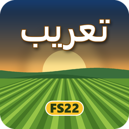

<p align="center"></p>

# تعريب Farming Simulator 22

مود يعرّب اللعبة (الإصدار 1.14): يصل الحروف العربية ويرتّبها من اليمين إلى اليسار، ويترجم 4059 نصاً من 4206 (97٪). ومعه أداة تضيف الحروف العربية إلى خط اللعبة على جهازك.

**المطوّر:** mohamedabdelguom — Mohamedabdelguom@gmail.com

**تحميل المود جاهزاً:** [FS22_ArabicLanguage.zip](https://github.com/Mohamedabdelguom1/FS22-Arabic-Mod/releases/latest/download/FS22_ArabicLanguage.zip)

## طريقة التشغيل

> **تنبيه مهم:** المود وحده لا يكفي. يجب تثبيت الخط العربي معه (الخطوة 1)، وإلا ظهرت النصوص العربية فراغاً، وظهرت رسالة «Character not found» في سجل اللعبة.

1. **ثبّت الخط العربي** بالأداة الموجودة في المستودع. تأخذ الأداة الحروف من خط ويندوز (Segoe UI) على جهازك وتضيفها إلى خط اللعبة، وتحفظ الخط الأصلي تلقائياً قبل أي تعديل.
   - ثبّت [بايثون](https://www.python.org/downloads/)، ثم المكتبتين:
     ```bash
     pip install numpy pillow
     ```
   - حمّل المستودع (زر Code ثم Download ZIP) وفكّ ضغطه، ثم شغّل من داخله:
     ```bash
     python FS22-Arabic-v0.3.0/tools/add_arabic_glyphs.py --game "D:\Games\Farming Simulator 22"
     ```
     ضع مكان المسار مجلد اللعبة عندك.
2. **ثبّت المود:** ضع `FS22_ArabicLanguage.zip` كما هو، دون فك الضغط، في:
   `Documents\My Games\FarmingSimulator2022\mods\`
3. **شغّل اللعبة:** افتح حفظاً جديداً أو قديماً، وفعّل «Arabic Language» في قائمة المودات قبل البدء.
4. **تأكّد:** يظهر أعلى الشاشة لعشرين ثانية سطر «مود التعريب يعمل» مع عدد النصوص المترجمة.

القائمة الرئيسية تبقى إنجليزية، لأن المودات لا تُحمَّل إلا عند فتح الحفظ.
بعد كل تحديث للعبة قد يعود الخط الأصلي، فأعد تشغيل الأداة.

**الإلغاء:** احذف المود من مجلد المودات، وأعد الخط الأصلي:
```bash
python FS22-Arabic-v0.3.0/tools/add_arabic_glyphs.py --game "D:\Games\Farming Simulator 22" --restore
```

## محتويات المستودع

- التثبيت وتعديل الترجمة: [FS22-Arabic-v0.3.0/تثبيت.md](FS22-Arabic-v0.3.0/تثبيت.md)
- المود الجاهز: `FS22-Arabic-v0.3.0/FS22_ArabicLanguage.zip`
- مصدر المود: `FS22-Arabic-v0.3.0/source/`
- ملفات الترجمة: `FS22-Arabic-v0.3.0/translation/`
- الأدوات (الخط، المعاينة، الاختبار، بناء الترجمة، الصورة): `FS22-Arabic-v0.3.0/tools/`
- الوثائق: `FS22-Arabic-v0.3.0/docs/`

لا يحوي المستودع ملفات من اللعبة ولا من خطوط مايكروسوفت: الخط يُبنى على جهاز كل مستخدم من نسخته.
Farming Simulator علامة تجارية لشركة GIANTS Software، وهذا المود غير رسمي.
